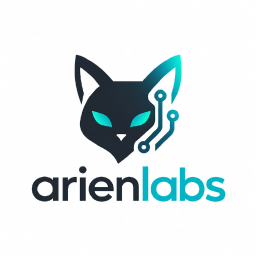

# Arienlabs IP Location Client for Go



A Go client for [Arienlabs IP Location API](https://github.com/arienlabs/ip-location-api). Supports IPv4, IPv6, ASN, batch lookup and health. Requires Go 1.24 or newer and uses only the standard library.

## Install

```sh
go get github.com/arienlabs/ip-location-client-go@v1.0.0
```

## Lookup

```go
package main

import (
    "context"
    "fmt"
    "log"

    iploc "github.com/arienlabs/ip-location-client-go"
)

func main() {
    client, err := iploc.New("http://localhost:8888/")
    if err != nil { log.Fatal(err) }

    location, err := client.Lookup(context.Background(), "8.8.8.8")
    if err != nil { log.Fatal(err) }
    if location == nil { fmt.Println("Not found"); return }
    fmt.Println(location.Country)
}
```

`New` creates an HTTP client with a five-second timeout. To supply your own transport or timeout:

```go
client, err := iploc.New("http://localhost:8888/",
    iploc.WithHTTPClient(&http.Client{Timeout: 3 * time.Second}))
```

The library does not close a caller-supplied HTTP client. Clients support concurrent goroutines. URL path prefixes are preserved; URLs with query parameters, fragments or embedded credentials are rejected.

## Batch and health

```go
results, err := client.LookupBatch(ctx, []string{
    "8.8.8.8", "2001:4860:4860::8888", "8.8.8.8",
})
if err != nil { return err }

health, err := client.Health(ctx)
if err != nil { return err }
fmt.Println(health.Ready, health.UpdateEnabled)
```

- Up to 100 input addresses. Duplicate normalized addresses are sent once; empty batches do not perform HTTP.
- Batch keys use canonical IP literals. IPv4-mapped IPv6 is normalized to IPv4. Missing addresses are omitted.
- Coordinates accept numeric and quoted JSON values. `*float64` distinguishes missing values from zero. Optional numeric ASN fields are pointers as well.
- Hostnames, CIDR ranges, IPv6 zones and ambiguous shorthand/octal IPv4 are rejected before HTTP.
- Responses are limited to 1 MiB. Invalid JSON, invalid coordinates and null result objects are errors.

## Errors and application policy

`Lookup` returns `(nil, nil)` only for HTTP 404. Other HTTP failures return `*iploc.APIError` with `StatusCode` and a size-limited `ResponseBody`; use `errors.As` to inspect it. Transport errors, `context.Canceled` and `context.DeadlineExceeded` are preserved. Health HTTP 503 with a valid body is returned as a health state with `Ready == false`.

No retries or fake locations are added. In particular, private/local addresses are not automatically mapped to Poland. Put any such business rule in a consuming application adapter and test it there.

## Tests

```sh
go test -race -count=1 -coverprofile=coverage.out ./...
go vet ./...
```

Tests cover full JSON fields, quoted/numeric coordinates, zero versus missing values, IPv6, URL prefixes, normalization, batch deduplication, errors, response bounds, cancellation, deadlines, concurrent access and HTTP configuration. The client has no third-party runtime dependencies.
